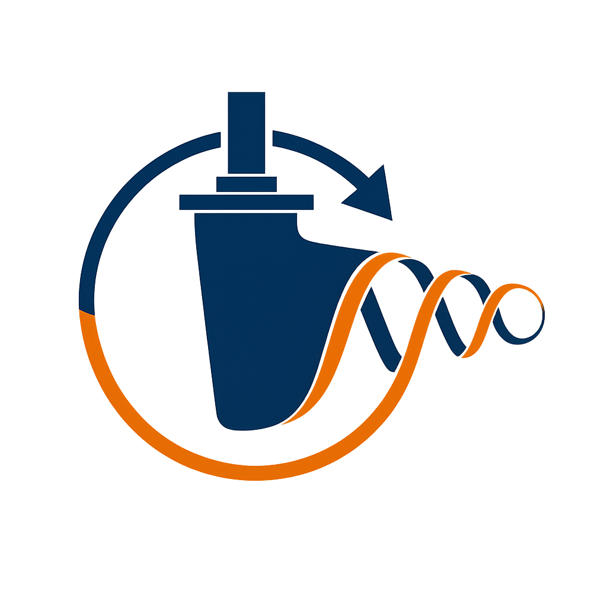

<p align="center">
  
</p>

# GNC Simulator

[](https://www.python.org/downloads/release/python-3120/)
[](https://github.com/astral-sh/uv)
[](https://pypi.python.org/pypi/uv)
[](https://opensource.org/licenses/Apache-2.0)
[](https://doi.org/10.5281/zenodo.20731296)

Python-based vessel guidance, navigation and control (GNC) simulator for exploring
motion models, route following, collision-free planning, feedback control and
simulation pipelines.

---

## Documentation

Read the **[GNC Simulator manual](https://jakendarth.github.io/GNC_simulator/)** for installation instructions, scenario guidance and explanations of how simulator functions connect into pipelines. It covers vessel and environmental models, semantic annotations, guidance, navigation, controllers, recorded demonstrations and related publications.

The manual also includes a generated [function catalog](https://jakendarth.github.io/GNC_simulator/reference/functions/) with signatures and source links. See [documentation maintenance](docs/developer/documentation.md) to build or update the manual locally.

---

## 🚀 Getting Started

### Requirements

The simulator requires Python 3.12 or newer, [uv](https://docs.astral.sh/uv/), and a graphical desktop environment for its Pygame window and interactive plots.

### Install and run

```sh
git clone https://github.com/Jakendarth/GNC_simulator.git
cd GNC_simulator
uv sync
mkdir -p output
uv run python main.py output
```

By default, `main.py` selects a JSON configuration from `input/`. To use another supported scenario configuration, change the `input_file` setting in `main.py`. The simulator writes outputs to the selected output directory. See the [installation guide](https://jakendarth.github.io/GNC_simulator/installation/) and [user guide](https://jakendarth.github.io/GNC_simulator/user-guide/) for configuration and output details.

---

## 📚 How to Cite

If you use this software in your research, academic work, or projects, please cite it. All necessary metadata and formatting information can be found in the `CITATION.cff` file located in the root of this repository. 

*Tip: You can also easily generate citations in your preferred format by clicking the **"Cite this repository"** button in the "About" section on the right side of the GitHub repository page.*

---

## Acknowledgements

This software was developed during Nikos Kougiatsos's involvement with SAFE-NET and Delft University of Technology. See the manual's [Organisations](https://jakendarth.github.io/GNC_simulator/organisations/) and [Projects](https://jakendarth.github.io/GNC_simulator/projects/) pages for context.

---

## 📝 License

This project is licensed under the **Apache License 2.0**. See [`LICENSE`](LICENSE) and [`NOTICE`](NOTICE) for the full terms and notices, or read the plain-language [Licence and Use guide](https://jakendarth.github.io/GNC_simulator/licence-and-use/).


