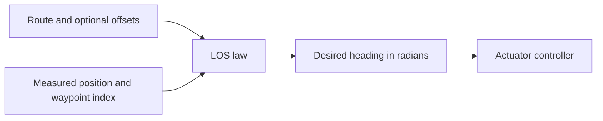

# Line-of-Sight Laws

A line-of-sight (LOS) law converts a route and measured vessel position into a desired heading. Use it after a path has been selected and before an actuator controller runs.

By the end of this page, you should be able to identify the active route segment, explain how cross-track error changes heading, and connect a LOS reference to PID or MPC control. First read [state and sensor conventions](../navigation/state-and-sensors.md).



## Standard LOS law

Standard LOS steers toward the route while correcting lateral deviation. It projects measured position onto the active segment and advances past segments already crossed. Let \(\alpha\) be segment heading in radians, \(y_e\) signed cross-track error in metres, and \(L\) vessel length in metres. With lookahead distance \(\Delta\), the correction is:

$$
\psi_{raw}=\alpha-\operatorname{atan2}(y_e,\Delta),\qquad\Delta=5L.
$$

The function wraps the result to the angle range and limits each heading change to \((\pi/90)\,\texttt{vessel.timestep}\) radians. At the route end it holds the previous desired heading. `vessel.timestep` defaults to 1; changing a pipeline's integration interval does not automatically update this member. Standard LOS uses `5 * L` for lookahead, independently of the JSON `Lookahead distance` field.


## Adaptive LOS and virtual sensing

The adaptive variant also integrates `eso_rhs`, an extended-state observer used to estimate motion and disturbance/fault-related quantities. It records estimated speed, heading, sideslip and cross-track histories, and reads lookahead from `input/SimParam.json`. Choose it only after checking the observer state and history requirements; sharing a heading return value does not make it a direct replacement for standard LOS.


This version crosses the Guidance/Navigation boundary: it integrates an observer and uses estimated cross-track and sideslip quantities to calculate heading. Read [State Observers](../navigation/observers.md) before substituting it into a pipeline. The default anti-grounding scenario uses standard LOS.

## Functions and inputs

| Function | Purpose | Result and important state |
| --- | --- | --- |
| `compute_LOS_ref(vessel, d_route, current_script_dir)` | Tracks an original or offset route | Heading in radians; updates waypoint index, cross-track error and heading history |
| `compute_LOS_ref_adaptive(...)` | Couples route following to an extended-state observer | Heading plus observer/history updates; reads `input/SimParam.json` |

## Connect guidance to a controller

Use this fragment inside a pipeline after initializing `barge`, its numeric route, ontology histories and timestep. The existing anti-grounding pipelines import the guidance and controller functions used here:

```python
# route_offsets=None follows the original route.
psi_d = compute_LOS_ref(barge, None, current_script_dir)
delta = PID_controller(barge, psi_d, t_step)
barge.u.append(delta)
```

This is a loop fragment, not a standalone program: route, ontology histories and vessel state must already be initialized. The [pipeline examples](../pipelines.md) show the surrounding sequence, and [recorded encounters](../demonstrations.md#encounter-recordings) provide visual context.


## What to check in a new pipeline

- Supply a two-row numeric route and nonempty measured-position histories.
- Keep `vessel.timestep` consistent with the intended heading-change interval.
- Choose original-route tracking (`d_route=None`) or offset tracking deliberately.
- Match the adaptive law's observer and history requirements; it reads a different JSON file from standard LOS.

Continue with [Collision-free Path Planning](collision-free-planning.md) to construct an adjusted route, or [Control](../topics/control.md) to turn the reference into commands.

## Related publications

- [Integrating rule awareness and semantic reasoning in collision-free vessel path planning](../publications.md#rule-aware-collision-free-planning) — research context for role assignment, path envelopes and LOS.
- [Virtual sensor-informed motion planning for safe autonomous waterborne navigation](../publications.md#virtual-sensor-informed-motion-planning) — related virtual-sensing work, listed with its supplied proceedings status.

Source: [`intel_guidance.py`](https://github.com/Jakendarth/GNC_simulator/blob/main/src/modules/intel_guidance.py), including [CPA](https://github.com/Jakendarth/GNC_simulator/blob/main/src/modules/intel_guidance.py#L421-L435), [LOS](https://github.com/Jakendarth/GNC_simulator/blob/main/src/modules/intel_guidance.py#L573-L638), and [global planning](https://github.com/Jakendarth/GNC_simulator/blob/main/src/modules/intel_guidance.py#L841-L874).
