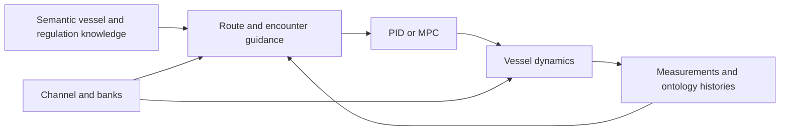

# GNC Simulator

{ .wiki-logo width="180" }

## Maritime guidance, navigation and control

GNC Simulator is a Python environment for studying vessel guidance, navigation and control (GNC). It combines vessel motion models, route-following and encounter-planning functions, actuator controllers, and Pygame visualization.

Use this wiki to run a scenario, understand its models, or connect existing functions into a simulation pipeline. A pipeline is the Python function that initializes a scenario and coordinates each simulation step.

[Explore the pipelines](pipelines.md){ .md-button .md-button--primary }
[Watch demonstrations](demonstrations.md){ .md-button }

## Explore by topic

If you are new to the repository, read [Installation](installation.md), then [Running and inspecting results](user-guide.md). To understand the design before running it, follow Semantics → Guidance → Control and Dynamics → Pipelines below.

-   **Semantics and knowledge**

    Understand the shared vocabulary for vessels, sensors and regulations, and how Python functions use it during a run.

    [Open Semantics](topics/semantics.md)

-   **Guidance and planning**

    Follow a route from waypoint generation through encounter assessment to a line-of-sight (LOS) heading reference.

    [Open Guidance](topics/guidance.md)

-   **Control and dynamics**

    Learn how proportional–integral–derivative (PID) control or model predictive control (MPC) produces commands, and how the vessel model responds.

    [Open Control](topics/control.md) · [Open Dynamics](topics/dynamics.md)

-   **Pipelines and examples**

    Work through the existing anti-grounding loop, substitute PID control, and inspect an encounter-aware integration example.

    [Connect the functions](pipelines.md)

-   **Recorded demonstrations**

    Watch existing navigation and encounter recordings alongside the functions they help illustrate.

    [Watch the videos](demonstrations.md)

-   **Research and publications**

    Find related papers, topic reading suggestions and copyable citations.

    [Browse publications](publications.md)

## A map of the simulator

Guidance selects a heading reference; control converts it to actuator commands; dynamics calculate the resulting motion. Measurements feed the next guidance step. The diagram also shows the encounter-reasoning path, which is available separately from the default anti-grounding scenario.

Use the [function catalog](reference/functions.md) when you need an exact signature or source location. It covers module-level functions and class methods, including rendering, sensing, export and plotting helpers. The topic pages explain how the principal functions behave and connect.

!!! note "Current implementation status"
    Start with the synthetic anti-grounding MPC scenario selected by `main.py`. Some older scenarios use interfaces that no longer match the current functions. Review [validation and known gaps](openwiki/testing/validation.md) before using those paths. Existing recordings and publications provide context; they do not verify a new run.

## About this wiki

The maintained pages explain concepts and procedures for engineers and researchers. The function catalog is generated from current Python definitions. OpenWiki pages provide additional source-grounded reference material and retain their original evidence records.

Source code, issues and citation information are available in the [GitHub repository](https://github.com/Jakendarth/GNC_simulator). See the repository's [citation metadata](https://github.com/Jakendarth/GNC_simulator/blob/main/CITATION.cff) and [Apache 2.0 license](https://github.com/Jakendarth/GNC_simulator/blob/main/LICENSE).
