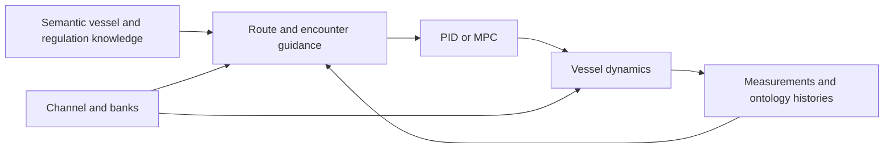

# GNC Simulator

{ .wiki-logo width="180" }

## Understand the functions. Connect the pipeline.

Explore how semantic vessel knowledge, encounter reasoning, guidance, control and numerical dynamics work together. Each topic explains the underlying meaning, identifies the functions that implement it and leads into a pipeline example.

[Explore the pipelines](pipelines.md){ .md-button .md-button--primary }
[Watch demonstrations](demonstrations.md){ .md-button }

## Explore by topic

-   **Semantics and knowledge**

    Learn what the ontology represents, how vessel and sensor data acquire meaning, and how regulation concepts enter decisions.

    [Open Semantics](topics/semantics.md)

-   **Guidance and planning**

    Follow route generation, closest approach, encounter roles, path envelopes and LOS heading references.

    [Open Guidance](topics/guidance.md)

-   **Control and dynamics**

    Connect PID or predictive control to actuator commands, numerical motion, channel depth and measured state.

    [Open Control](topics/control.md) · [Open Dynamics](topics/dynamics.md)

-   **Pipelines and examples**

    See the active MPC sequence, its PID variant, and the current contracts for an encounter-aware composition.

    [Connect the functions](pipelines.md)

-   **Recorded demonstrations**

    Watch the repository's PID, NMPC, crossing and head-on recordings alongside their relevant topics.

    [Watch the videos](demonstrations.md)

-   **Research and publications**

    Read the associated work on semantic planning, mission adaptation and virtual-sensor-informed motion planning.

    [Browse publications](publications.md)

## A map of the simulator

Start with [installation](installation.md) to run the application, or use the [function catalog](reference/functions.md) to look up exact source signatures. The catalog includes the supporting rendering, sensing, export and plotting functions as well as the core GNC components.

!!! note "Current implementation status"
    The default configuration selects the synthetic anti-grounding MPC scenario. Older scenarios have documented interface gaps. Recorded videos and research publications provide context; current implementation details are grounded in source. See [validation and known gaps](openwiki/testing/validation.md).

## About this wiki

The wiki combines authored conceptual explanations, source-linked function contracts, pipeline examples and an automatically generated function catalog. The existing OpenWiki reference remains available without changing its generated Markdown or evidence records.

Source code, issues and citation information are available in the [GitHub repository](https://github.com/Jakendarth/GNC_simulator). See the repository's [citation metadata](https://github.com/Jakendarth/GNC_simulator/blob/main/CITATION.cff) and [Apache 2.0 license](https://github.com/Jakendarth/GNC_simulator/blob/main/LICENSE).
