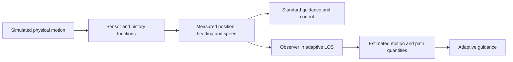

# Navigation

Navigation answers: **where is the vessel, how is it moving, and which quantities are available to guidance and control?** In this simulator, physical motion, simulated measurements and observer estimates are stored separately.

## Learning path

| Read | What you will learn |
| --- | --- |
| [State and Sensors](state-and-sensors.md) | Distinguish physical state from measurements; interpret coordinates, units, noise and histories |
| [State Observers](observers.md) | Trace the extended-state observer used by adaptive LOS and identify its estimated quantities |

Start with the measurements used by the default pipeline. Then study the observer path, which couples estimation with adaptive guidance. The default anti-grounding scenario uses standard LOS and does not call that observer through adaptive LOS.

The [vessel and environment reference](../topics/dynamics.md) explains the physical models that generate simulated motion. Those models support navigation experiments; they are distinct from estimating the vessel's motion from measurements.

Some existing pipeline comments label physical integration as “Navigation system.” The wiki separates that simulation step from measurement and estimation so you can follow each responsibility explicitly.

Continue to [Guidance](../topics/guidance.md) to select a reference path and heading, [Control](../topics/control.md) to calculate actuator commands, or [Pipelines](../pipelines.md) to see the complete loop.
