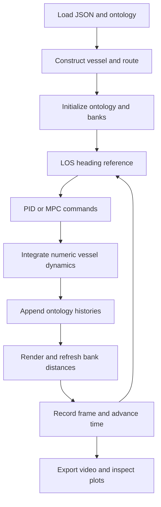
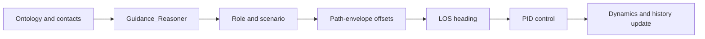

# Connecting the functions

A pipeline owns initialization, the sequence of guidance/control/dynamics calls, simulation time and output. Reusing individual functions requires preserving their state, geometry and history contracts.

## Pipeline interface

`main.py` imports the callable selected by JSON and invokes:

```python
run_simulation(screen, ontology, input_file, font, current_script_dir, output_dir)
```

The anti-grounding, PID and collision pipelines have this six-argument interface. The older FTC pipeline accepts four arguments and is not directly compatible. See [scenario configurations](scenarios.md) for how to select a callable.



## Example 1: the existing anti-grounding loop

The following is an explanatory extraction of the active calls in [`sim_ag_upg.py`](https://github.com/Jakendarth/GNC_simulator/blob/main/src/pipelines/sim_ag_upg.py#L87-L139). It belongs inside that pipeline after vessel, route, ontology histories and shoreline geometry are initialized; it is not a complete executable program.

```python
psi_d = compute_LOS_ref(barge, None, current_script_dir)

barge.Anti_Grounding_MPC_controller(
    psi_d=psi_d,
    MPC_prediction_horizon=5,
    MPC_time_step=t_step,
    min_depth=3.15,
    max_depth=3.3,
    sim_scale=sim_scale,
)
command = barge.get_next_ag_step()
barge.Np.append(float(command[0][0]))
barge.u.append(float(command[1][0]))

local_times, states = barge.differential_algebraic_model(t_step)
barge.dynamic_ontology_update(
    copy.deepcopy(states), psi_d, copy.deepcopy(local_times), time
)

shore_top, shore_bottom = create_inland_depth_varying_map(
    screen, barge, font, sim_scale, min_depth=3.15, max_depth=3.3
)
draw_vessels_no_map(
    screen, [barge], sim_scale, 0, time, times_to_draw, look_ahead
)
calc_bank_distances_shore(
    screen, [barge], sim_scale, times_to_draw, shore_top, shore_bottom
)
```

The surrounding pipeline handles Pygame events, frame recording, time increment and termination. Initial state is `[u,v,r,x,y,z,psi]`; `update_ontology_start_values` synchronizes initial pose/velocity values, and the route is a two-row numeric array. See [state ownership](openwiki/architecture/simulation-state.md) for the complete lifecycle.

## Example 2: substitute the existing PID controller

[`sim_ag_PID.py`](https://github.com/Jakendarth/GNC_simulator/blob/main/src/pipelines/sim_ag_PID.py#L87-L101) retains standard LOS and the same integration/history boundary, replacing the MPC block with:

```python
psi_d = compute_LOS_ref(barge, None, current_script_dir)
barge.u.append(PID_controller(barge, psi_d, t_step))
local_times, states = barge.differential_algebraic_model(t_step)
barge.dynamic_ontology_update(
    copy.deepcopy(states), psi_d, copy.deepcopy(local_times), time
)
```

This is a heading-control substitution: it does not solve the anti-grounding MPC optimization, and it leaves the initialized propeller-speed history in place. Both variants currently use the same video output name, so preserve recordings before comparing runs. Watch the separate [navigation recordings](demonstrations.md#navigation-recordings) for context.

## Example 3: connect encounter reasoning to LOS

An encounter-aware composition has an additional stage before control:



This adapter fragment illustrates the **current six-result function contract**. It requires an initialized vessel, initialized contacts, current signed bank distances, and a nondegenerate boundary polyline in screen coordinates:

```python
offsets, safe_speed, safe_distance, scenario, contacts, segment = (
    Guidance_Reasoner(
        time, vessel, other_vessels, ontology, sim_scale,
        current_script_dir, map=boundary_polyline,
    )
)
psi_d = compute_LOS_ref(vessel, offsets, current_script_dir)
vessel.u.append(PID_controller(vessel, psi_d, t_step))
```

The returned `safe_speed` is not automatically a speed-control command; this fragment only connects the heading path. `Guidance_Reasoner` itself mutates role/scenario and regulation histories.

!!! note "Integration example, not a repaired collision pipeline"
    The shipped `sim_colav.py` still unpacks five results, omits the map expected downstream and calls drawing with an older signature. The fragment above explains how the current functions connect; it does not claim the full collision pipeline has been fixed or runtime validated. Contact filtering and numerical degeneracies also need focused validation.

## Data contracts at the seams

| Seam | Preserve |
| --- | --- |
| Route → guidance | Two equal-length coordinate rows; offsets with matching shape |
| Ontology → guidance | Nonempty measured-position, heading and speed histories |
| Guidance → control | Heading reference in radians; consistent `timestep`/`dt` conventions |
| MPC → dynamics | Append propeller command to `Np`, rudder command to `u` |
| Dynamics → histories | Six integrator rows, local sample times and global step start time |
| Geometry → bank measurement | Screen/world scaling and the negative screen y convention |
| Histories → plotting/export | Current-run data and aligned columns; do not assume every consumer uses the CLI output directory |

The [function catalog](reference/functions.md) supplies exact signatures. The [validation reference](openwiki/testing/validation.md) records the known legacy gaps.

## Related publications

- [Integrating rule awareness and semantic reasoning in collision-free vessel path planning](publications.md#rule-aware-collision-free-planning) — the encounter-guidance architecture.
- [An intelligent agent-based resilient framework for marine vessel mission adaptations](publications.md#resilient-mission-adaptation) — architectural composition and mission-adaptation context beyond the current navigation loop.
