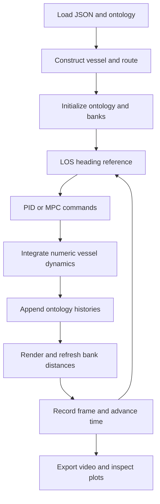

# Connecting the functions

A pipeline coordinates one simulation scenario: it initializes vessels and routes, runs guidance and control, integrates motion, and records results. Use the examples below to trace the existing implementation or identify the boundaries a new pipeline must preserve.

Read [state and coordinate meanings](topics/dynamics.md#state-and-coordinate-meanings) first if you are unfamiliar with the vessel state. The examples are loop fragments checked against source; they are not standalone programs or runtime-validated experiments.

## Pipeline interface

The selected JSON file names a `run_simulation` callable. `main.py` loads it and passes the graphical display, ontology, input path, font, repository directory and output directory:

```python
run_simulation(screen, ontology, input_file, font, current_script_dir, output_dir)
```

The anti-grounding, proportional–integral–derivative (PID) and collision pipelines accept these six arguments. The older fault-tolerant control (FTC) pipeline accepts four. Check [scenario configurations](scenarios.md) before selecting a callable.

The diagram shows the single-vessel sequence used by the anti-grounding variants. Model predictive control (MPC) or PID supplies commands between guidance and integration.



## Example 1: the existing anti-grounding loop

Use this example to follow one iteration of [`sim_ag_upg.py`](https://github.com/Jakendarth/GNC_simulator/blob/main/src/pipelines/sim_ag_upg.py#L87-L139). Before entering the loop, that pipeline creates `barge`, initializes its ontology histories, assigns a numeric route and measures initial bank distances.

The fragment uses the pipeline's imported functions and `copy` module. It also assumes its `screen`, `font`, `t_step`, `sim_scale`, `time`, `times_to_draw`, `look_ahead` and `current_script_dir` variables. The calls proceed in this order: calculate heading, obtain actuator commands, integrate motion, append histories, then refresh rendering and bank distances.

```python
psi_d = compute_LOS_ref(barge, None, current_script_dir)

barge.Anti_Grounding_MPC_controller(
    psi_d=psi_d,
    MPC_prediction_horizon=5,
    MPC_time_step=t_step,
    min_depth=3.15,
    max_depth=3.3,
    sim_scale=sim_scale,
)
command = barge.get_next_ag_step()
barge.Np.append(float(command[0][0]))
barge.u.append(float(command[1][0]))

local_times, states = barge.differential_algebraic_model(t_step)
barge.dynamic_ontology_update(
    copy.deepcopy(states), psi_d, copy.deepcopy(local_times), time
)

shore_top, shore_bottom = create_inland_depth_varying_map(
    screen, barge, font, sim_scale, min_depth=3.15, max_depth=3.3
)
draw_vessels_no_map(
    screen, [barge], sim_scale, 0, time, times_to_draw, look_ahead
)
calc_bank_distances_shore(
    screen, [barge], sim_scale, times_to_draw, shore_top, shore_bottom
)
```

The surrounding loop handles window events, frame recording, time increment and termination. `update_ontology_start_values` synchronizes initial pose and velocity values with state `[u,v,r,x,y,z,psi]`. Routes have two coordinate rows. See [state ownership](openwiki/architecture/simulation-state.md) for initialization and history details.

After the integration call, `barge.state` contains the terminal physical state and the ontology contains the new sampled histories. Bank distances measured during this redraw become inputs to the next iteration.

## Example 2: substitute the existing PID controller

Use this variation to see how the controller can change while guidance and integration retain the same interfaces. [`sim_ag_PID.py`](https://github.com/Jakendarth/GNC_simulator/blob/main/src/pipelines/sim_ag_PID.py#L87-L101) uses standard line-of-sight (LOS) guidance, appends a PID rudder command and follows the same integration/history sequence:

```python
psi_d = compute_LOS_ref(barge, None, current_script_dir)
barge.u.append(PID_controller(barge, psi_d, t_step))
local_times, states = barge.differential_algebraic_model(t_step)
barge.dynamic_ontology_update(
    copy.deepcopy(states), psi_d, copy.deepcopy(local_times), time
)
```

This substitutes heading control only. It leaves propeller speed at the initialized command and does not optimize the MPC clearance constraint. Both variants write the same video filename, so preserve outputs between runs. The [navigation recordings](demonstrations.md#navigation-recordings) provide examples of recorded behavior.

## Example 3: connect encounter reasoning to LOS

Encounter-aware guidance adds a planning stage before heading control. It evaluates contacts and roles, then supplies route offsets to LOS:


This fragment illustrates the **current six-result function contract**. Initialize the vessel and contacts, supply current signed bank distances, and provide `boundary_polyline` in screen coordinates with at least two distinct points and no zero-length segments. The reasoner needs this boundary to find the nearest segment:

```python
offsets, safe_speed, safe_distance, scenario, contacts, segment = (
    Guidance_Reasoner(
        time, vessel, other_vessels, ontology, sim_scale,
        current_script_dir, map=boundary_polyline,
    )
)
psi_d = compute_LOS_ref(vessel, offsets, current_script_dir)
vessel.u.append(PID_controller(vessel, psi_d, t_step))
```

`offsets` supplies the adjusted reference path to LOS. The reasoner also updates role, scenario and regulation histories. Although it returns `safe_speed`, this fragment does not connect that value to a speed controller.

:::{admonition} Integration example, not a repaired collision pipeline
:class: note

`sim_colav.py` still unpacks five results, omits the required map downstream and uses an older drawing signature. This fragment documents the current interfaces; it does not repair that complete pipeline. Contact filtering and numerical degeneracies remain validation concerns.

:::

## Data contracts at the seams

| Connection | Required agreement |
| --- | --- |
| Route → guidance | Two equal-length coordinate rows; offsets with matching shape |
| Ontology → guidance | Nonempty measured-position, heading and speed histories |
| Guidance → control | Heading reference in radians; consistent `timestep`/`dt` conventions |
| MPC → dynamics | Append propeller command to `Np`, rudder command to `u` |
| Dynamics → histories | Six integrator rows, local sample times and global step start time |
| Geometry → bank measurement | Screen/world scaling and the negative screen y convention |
| Histories → plotting/export | Current-run data and aligned columns; do not assume every consumer uses the CLI output directory |

The [function catalog](reference/functions.md) supplies exact signatures. The [validation reference](openwiki/testing/validation.md) records the known legacy gaps.

## Related publications

- [Integrating rule awareness and semantic reasoning in collision-free vessel path planning](publications.md#rule-aware-collision-free-planning) — the encounter-guidance architecture.
- [An intelligent agent-based resilient framework for marine vessel mission adaptations](publications.md#resilient-mission-adaptation) — architectural composition and mission-adaptation context beyond the current navigation loop.
