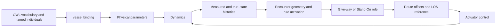

# Dynamic Updates

Dynamic updates keep the semantic model connected to a simulation as the vessel moves. Initial values describe a starting condition; runtime histories record what the model, sensors and controller produce over time.

After [Semantic Annotation](annotation.md), use this page to understand **which values are changed, by which functions, and when**. [Semantic Reasoning](reasoning.md) then explains how those updated values enter decisions.

## Initialization and runtime updates

| Function | When it is used | What it changes |
| --- | --- | --- |
| `vessel.__init__(name, ontology, x0)` | Vessel construction | Binds the named ontology individual and initializes Python state, route/controller fields and histories |
| `update_ontology_start_values(player, x0)` | Initialization in the anti-grounding pipelines | Replaces initial measured/physical pose and velocity entries; copies numeric state |
| `ontology_input_sync(ontology, traffic_config_file)` | An explicit CSV synchronization step | Replaces matching individuals' initial fields from named CSV columns and prints their properties |
| `sensor_output()` | After numerical integration in the model path | Refreshes the Python measured-state vector |
| `dynamic_ontology_update(mystate, reference, mytime, start_time)` | After the pipeline's integration call | Appends physical trajectory, noisy measurement, reference, command, bank-distance and clearance histories |

CSV synchronization and the runtime updater serve different purposes. Calling one does not automatically call the other.

## The history-update contract

`dynamic_ontology_update` consumes six rows of integration samples ordered `[u, v, r, x, y, psi]`, a desired heading, local sample times, and the global start time of the simulation step. The vessel's stored physical state has an additional sinkage entry; see [state conventions](../topics/dynamics.md#state-and-coordinate-meanings).

| Stored values | How the updater fills them |
| --- | --- |
| `x`, `y`, `psi` | Physical integration samples |
| `yx`, `yy`, `ypsi` | Samples perturbed by the separate absolute position/heading noise settings |
| `SOG` | Speed magnitude with relative measurement noise |
| `psi_d`, `rudder_angle`, `propeller_speed` | The current reference and commands, repeated over the integration samples |
| `starboard_distance`, `port_distance`, `zhat` | The currently stored bank distances and sinkage, repeated over those samples |
| `time` | Each local sample time plus `start_time` |
| `UKC` | Depth queries minus draught and the stored sinkage |

A step can append multiple values to each history. A displayed frame, an integration step and a history sample are therefore different units of progress. Read a current parameter with the convention its consumer expects, and use the latest measured history entry for functions that expect `[-1]`.

## Connect integration to the ontology

Inside an initialized pipeline, the existing boundary is:

```python
local_times, states = barge.differential_algebraic_model(t_step)
barge.dynamic_ontology_update(
    copy.deepcopy(states), psi_d, copy.deepcopy(local_times), time
)
```

This is a fragment using the pipeline's imported `copy` module and initialized vessel, heading reference, timestep and global time. The [pipeline example](../pipelines.md#example-1-the-existing-anti-grounding-loop) shows the guidance and command calls before it and the redraw/bank measurements after it.

## Storage and ordering implications

The ontology is mutable in-memory state loaded from XML. This pipeline appends histories but does not save the updated ontology back to the original XML file. CSV export and plotting read the populated histories separately.

In the default loop, bank distances refresh after integration, so the updater records the distances available before that redraw. Depth logging, numerical dynamics and controller prediction also use different scale conversions; inspect the [depth-coupling reference](../openwiki/concepts/guidance-control.md#depth-geometry-and-coupling) before equating their clearance values.

Traffic-rule `reg_active` histories are updated by `Guidance_Reasoner`, not by `dynamic_ontology_update`. Python `role` and `scenario` fields are also decisions on the vessel object. Follow [Semantic Reasoning](reasoning.md) for that part of the lifecycle.



The diagram shows how parameters, histories and decisions connect across the full encounter-aware loop. The default anti-grounding scenario skips the encounter-reasoning stage.

Source: [`classes.py`](https://github.com/Jakendarth/GNC_simulator/blob/main/src/modules/classes.py#L122-L148), [initial-value synchronization](https://github.com/Jakendarth/GNC_simulator/blob/main/src/modules/helper_utils.py#L350-L361), and [CSV synchronization](https://github.com/Jakendarth/GNC_simulator/blob/main/src/modules/helper_utils.py#L741-L778).
