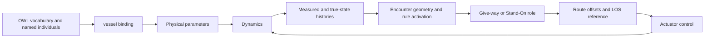

# Semantic model and runtime meaning

The simulator uses an ontology—a structured vocabulary and a set of named objects—to connect vessel parameters, sensor information and regulation-related concepts. This shared model gives numerical values a meaning that other functions can use.

Read this page to understand what is stored in the ontology and how Python decisions use it. Then follow [Guidance](guidance.md) to see how those decisions affect a reference path.

## What the ontology represents

The Web Ontology Language (OWL) describes classes, individuals and properties. A class names a category, an individual names a particular object, an object property connects individuals, and a data property attaches a value. For the underlying terminology, see the [W3C OWL 2 Primer](https://www.w3.org/TR/owl2-primer/).

At startup, the simulator loads [`assets/database.xml`](https://github.com/Jakendarth/GNC_simulator/blob/main/assets/database.xml), an ontology serialized in RDF/XML. The similarly named XML file at the repository root is not the file loaded by `main.py`.

| Concept in the file | Meaning in this simulator | Examples |
| --- | --- | --- |
| Classes | Vocabulary for the modeled system | `Vessel`, `Sensors`, `Environment`, `Regulations`, `Operators`, `Design_space` |
| Individuals | Named objects described using that vocabulary | `Own`, `Other1`–`Other4`, `GNSS`, `Radar`, `Operational_environment` |
| Physical data | Geometry and hydrodynamic parameters read by numerical models | `L`, `B`, `Td`, `Cb`, `m`, force coefficients |
| Runtime data | Measurements, references, commands and state histories | `yx`, `yy`, `ypsi`, `psi_d`, `SOG`, `rudder_angle`, `UKC`, `time` |
| Regulation data | Named rule individuals and activation histories | `COLREGS/Rule_14`, `BPR/Article_604`, `reg_active` |
| Object properties | Declared information-flow relations | `inputFrom` and its inverse `outputTo` |

Creating `vessel("Own", ontology, x0)` associates a Python vessel object with `ontology.Own`. The Python object holds numeric state and controller state; the ontology supplies parameters and receives runtime histories. The constructor handles `Own`, `Other1`, `Other2` and `Other3` explicitly and maps all other names to `Other4`. To add a new vessel identity, review that mapping as well as the ontology.

## Three meanings to keep separate

**Domain semantics: what a value means.** `Td` represents vessel draught, `psi_d` represents desired heading, and a rule individual represents a regulation-related concept.

**Decision semantics: how a value affects behavior.** `Guidance_Reasoner` selects regulation groups, computes encounter geometry and calls `Finite_State_Machine` to assign a Give-way or Stand-On role. The role and scenario are stored on the Python vessel object.

**Execution semantics: when and where a value is read or written.** Functions commonly read parameters from the first ontology value, such as `L[0]`, and measurements from the latest value, such as `yx[-1]`. The integrator produces multiple samples within a simulation step; history updates append those samples rather than one value per displayed frame.



## Regulation activation and geometric decisions

The code uses two regulation labels: COLREGS for international collision regulations, and BPR for the Dutch inland navigation regulations. `Guidance_Reasoner` selects the COLREGS branch when scaled x ≤ 600 and the BPR branch beyond it. This threshold is part of the scenario logic, not a general geographic lookup.

The function traverses regulation groups with `INDIRECT_equivalent_to` and appends `reg_active` flags. The XML connects rule individuals and situation groups using `owl:sameAs`. In OWL, that relation asserts identity; it is stronger than a membership relation. Review this modeling choice before changing the ontology or adding formal inference.

Distance, closest point of approach (CPA) and relative angles feed the encounter-role decision. Give-way behavior leads to optimized route offsets; Stand-On behavior keeps zero offsets. The default anti-grounding pipeline follows a different path: it calls line-of-sight (LOS) guidance directly and skips encounter reasoning.

:::{admonition} Scope of reasoning
:class: note

`Guidance_Reasoner` makes explicit Python decisions using ontology data. It does not invoke an OWL consistency or classification reasoner on each step. The XML also contains CCNR groups, named for the Central Commission for the Navigation of the Rhine, but this function selects COLREGS or BPR. Named rules and activation flags alone do not establish complete regulatory compliance.

:::

## Functions that bridge knowledge and simulation

| Function | Inputs and responsibility | Output or mutation | Connects to |
| --- | --- | --- | --- |
| `vessel.__init__(name, ontology, x0)` | Vessel name, ontology and initial numeric state | Binds an individual; initializes controller, route and history state | All guidance/control functions |
| `update_ontology_start_values(player, x0)` | Existing vessel and initial state | Updates initial pose/velocity values and copies `state` | Pipeline initialization |
| `ontology_input_sync(ontology, traffic_config_file)` | Traffic CSV and existing ontology | Updates matching individuals' initial properties; prints their properties | CSV-driven scenarios |
| `dynamic_ontology_update(mystate, reference, mytime, start_time)` | Integrator samples, reference and local/global times | Appends physical/measurement histories and commands | Guidance on the next step, plots and CSV export |
| `Guidance_Reasoner(...)` | Vessel, contacts, ontology, scale and map polyline | Regulation activation history, roles and route offsets | LOS guidance |
| `Finite_State_Machine(...)` | Relative headings/bearing, range, CPA distance and bank distances | Mutates vessel `role` and `scenario` | Path-envelope selection |

## Reading and inspecting the model

Activate the simulator environment and run the following Python code from the repository root. It loads the ontology and prints `Own` vessel parameters and properties without opening the graphical interface. Printed property order may vary.

```python
from pathlib import Path
from owlready2 import get_ontology

root = Path.cwd()  # repository root
ontology = get_ontology(str(root / "assets/database.xml")).load()
print(ontology.Own.L[0])
print(ontology.Own.Td[0])
for prop in ontology.Own.get_properties():
    print(prop.python_name, prop[ontology.Own])
```

Continue with [pipeline composition](../pipelines.md) and [the function catalog](../reference/functions.md).

## Related publications

- [Integrating rule awareness and semantic reasoning in collision-free vessel path planning](../publications.md#rule-aware-collision-free-planning) — semantic traffic-rule information and encounter guidance.
- [An intelligent agent-based resilient framework for marine vessel mission adaptations](../publications.md#resilient-mission-adaptation) — the wider architecture and control perspective.

Source: [`classes.py`](https://github.com/Jakendarth/GNC_simulator/blob/main/src/modules/classes.py#L34-L148), [`helper_utils.py`](https://github.com/Jakendarth/GNC_simulator/blob/main/src/modules/helper_utils.py#L350-L361), and [`intel_guidance.py`](https://github.com/Jakendarth/GNC_simulator/blob/main/src/modules/intel_guidance.py#L83-L203).
