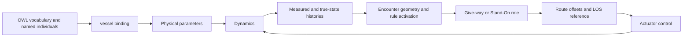

# Semantic model and runtime meaning

The simulator couples numerical vessel models to a shared vocabulary for vessels, sensors, operating conditions and regulations. This page explains that vocabulary and the Python functions that use it. The [guidance page](guidance.md) follows the resulting decisions into a reference path.

## What the ontology represents

An OWL ontology describes classes, individual objects and their properties. Object properties connect individuals; data properties attach values. This terminology follows the [W3C OWL 2 Primer](https://www.w3.org/TR/owl2-primer/). The simulator loads its RDF/XML ontology from [`assets/database.xml`](https://github.com/Jakendarth/GNC_simulator/blob/main/assets/database.xml).

| Concept in the file | Meaning in this simulator | Examples |
| --- | --- | --- |
| Classes | Vocabulary for the modeled system | `Vessel`, `Sensors`, `Environment`, `Regulations`, `Operators`, `Design_space` |
| Individuals | Named objects described using that vocabulary | `Own`, `Other1`–`Other4`, `GNSS`, `Radar`, `Operational_environment` |
| Physical data | Geometry and hydrodynamic parameters read by numerical models | `L`, `B`, `Td`, `Cb`, `m`, force coefficients |
| Runtime data | Measurements, references, commands and state histories | `yx`, `yy`, `ypsi`, `psi_d`, `SOG`, `rudder_angle`, `UKC`, `time` |
| Regulation data | Named rule individuals and activation histories | `COLREGS/Rule_14`, `BPR/Article_604`, `reg_active` |
| Object properties | Declared information-flow relations | `inputFrom` and its inverse `outputTo` |

The named vessels bind a Python object's numeric state to its ontology individual. Calling `vessel("Own", ontology, x0)` selects `ontology.Own`. Names other than the explicitly handled Own/Other1/Other2/Other3 names fall back to `Other4`; arbitrary new names are not automatically registered.

## Three meanings to keep separate

**Domain semantics** describe what a property or individual represents: `Td` is vessel draught, `psi_d` is desired heading, and a rule individual represents a regulation-related concept.

**Decision semantics** describe how the program acts on that knowledge. `Guidance_Reasoner` selects regulation groups, computes encounter geometry and calls `Finite_State_Machine` to assign a Give-way or Stand-On role. These roles and scenarios live on the Python vessel object.

**Execution semantics** describe storage and ordering. Functions often access physical parameters through the first ontology value (`L[0]`) and measurements through the latest value (`yx[-1]`). Runtime histories grow at the numerical integrator's sample times, not just once per displayed frame.



## Functions that bridge knowledge and simulation

| Function | Inputs and responsibility | Output or mutation | Connects to |
| --- | --- | --- | --- |
| `vessel.__init__(name, ontology, x0)` | Vessel name, ontology and initial numeric state | Binds an individual; initializes controller, route and history state | All guidance/control functions |
| `update_ontology_start_values(player, x0)` | Existing vessel and initial state | Updates initial pose/velocity values and copies `state` | Pipeline initialization |
| `ontology_input_sync(ontology, traffic_config_file)` | Traffic CSV and existing ontology | Updates matching individuals' initial properties; prints their properties | CSV-driven scenarios |
| `dynamic_ontology_update(mystate, reference, mytime, start_time)` | Integrator samples, reference and local/global times | Appends physical/measurement histories and commands | Guidance on the next step, plots and CSV export |
| `Guidance_Reasoner(...)` | Vessel, contacts, ontology, scale and map polyline | Regulation activation history, roles and route offsets | LOS guidance |
| `Finite_State_Machine(...)` | Relative headings/bearing, range, CPA distance and bank distances | Mutates vessel `role` and `scenario` | Path-envelope selection |

## Regulation activation and geometric decisions

`Guidance_Reasoner` chooses the COLREGS branch when scaled x ≤ 600 and the BPR branch beyond it. It traverses regulation groups with `INDIRECT_equivalent_to` and appends activation flags. Group membership in the XML uses `owl:sameAs` links; those links have identity semantics in OWL, rather than the meaning of a generic membership relation. This is a modeling detail to review if changing the ontology or adding formal inference.

The function then uses distance, closest point of approach and relative angles to assign encounter roles. A Give-way role leads to a geometric path-offset optimization; Stand-On retains zero offsets. The current default anti-grounding pipeline calls LOS directly and does not invoke this encounter reasoning stage.

!!! note "Scope of reasoning"
    The active path performs explicit Python decisions over ontology data. It does not call an OWL consistency/classification reasoner during each simulation step, and the presence of named regulations does not establish complete rule compliance. CCNR groups exist in the XML, while this function's active geographic branch selects COLREGS or BPR.

## Reading and inspecting the model

This inspection example requires the simulator environment but does not run its GUI:

```python
from pathlib import Path
from owlready2 import get_ontology

root = Path.cwd()  # repository root
ontology = get_ontology(str(root / "assets/database.xml")).load()
print(ontology.Own.L[0])
print(ontology.Own.Td[0])
for prop in ontology.Own.get_properties():
    print(prop.python_name, prop[ontology.Own])
```

Continue with [pipeline composition](../pipelines.md) and [the function catalog](../reference/functions.md).

## Related publications

- [Integrating rule awareness and semantic reasoning in collision-free vessel path planning](../publications.md#rule-aware-collision-free-planning) — semantic traffic-rule information and encounter guidance.
- [An intelligent agent-based resilient framework for marine vessel mission adaptations](../publications.md#resilient-mission-adaptation) — the wider architecture and control perspective.

Source: [`classes.py`](https://github.com/Jakendarth/GNC_simulator/blob/main/src/modules/classes.py#L34-L148), [`helper_utils.py`](https://github.com/Jakendarth/GNC_simulator/blob/main/src/modules/helper_utils.py#L350-L361), and [`intel_guidance.py`](https://github.com/Jakendarth/GNC_simulator/blob/main/src/modules/intel_guidance.py#L83-L203).
