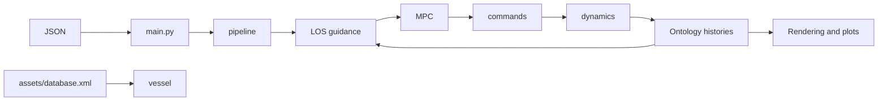

# Simulation lifecycle and vessel state

`main.py` owns startup: it adds source directories to the import path, loads the JSON-selected callable, initializes a 1200×800 Pygame display, loads `assets/database.xml`, and calls the pipeline with screen, ontology, input filename, font, repository directory and output directory. There is no application service or persistent simulation manager around this call.

## Ownership and data flow

The selected pipeline owns simulation time, termination, rendering and export. The default `sim_ag_upg` constructs an `Own` vessel and a synthetic channel route, initializes ontology values, and repeats:

1. Calculate a LOS heading reference.
2. Construct anti-grounding MPC and append propeller and rudder commands.
3. Integrate vessel dynamics and append sampled states to ontology histories.
4. Redraw the channel and vessel, refresh bank distances, report clearance and record a frame.

It stops on window close, simulation time, or the vessel's x position reaching the route end. Afterward it exports video, invokes grounding plots, resets the vessel and quits Pygame. Plot failures can interrupt that final cleanup sequence; it is not protected by `finally`.

## State conventions

The vessel's seven-element state is `[u, v, r, x, y, z, psi]`. The numerical integrator removes index 5, integrating `[u, v, r, x, y, psi]`; sinkage `z` is calculated during force evaluation and inserted afterward. MPC packs the same physical state into `[x, y, psi, u, v, r]`. Changes to ordering must be coordinated across integration, sensors and control adapters.

`vessel` holds control histories, routes, waypoint index, observer state, controller references and bank distances. Named vessels map to ontology individuals `Own`, `Other1`, `Other2`, `Other3`, with all other names falling back to `Other4`. Ontology properties provide physical parameters and append-only runtime histories. They are shared mutable in-memory data; startup loads the ontology, while this path does not save it back to XML.

## Dynamics and history boundaries

`differential_algebraic_model` updates mass/inertia parameters, calls SciPy `solve_ivp` with RK45 and tolerances `1e-8`, updates terminal state, calls `sensor_output`, and restores sinkage. The separate `run_models` helper uses Radau; it is a different integration path.

The dynamics apply four `force_switch` entries to hull, propeller, rudder and bank contributions. Depth changes sinkage and added mass. In the default pipeline all four contributions are enabled.

`dynamic_ontology_update` appends each integrator sample to position, heading, speed, command, bank-distance and time histories. Desired heading and current commands repeat across those samples. Positions and headings receive absolute random noise; speed receives relative measurement noise. Setting the JSON sensor-noise value to zero does not by itself remove the default positioning noise.

The default loop refreshes bank distances after integration, so the next control/dynamics step uses the distances measured in the previous redraw. UKC logging, pipeline clearance reporting and controller depth prediction use distinct call sites and scales; see [guidance and control](../concepts/guidance-control.md) before treating their values as interchangeable.

## Change routing

Add a new orchestration mode through the JSON import mechanism and the six-argument pipeline contract. Extend physics in `classes.py` and coordinate symbolic controller equations in `traffic_planner.py`; they are separate implementations. See [scenario configuration](../workflows/scenarios-results.md), [validation gaps](../testing/validation.md), and the [quickstart](../quickstart.md).
